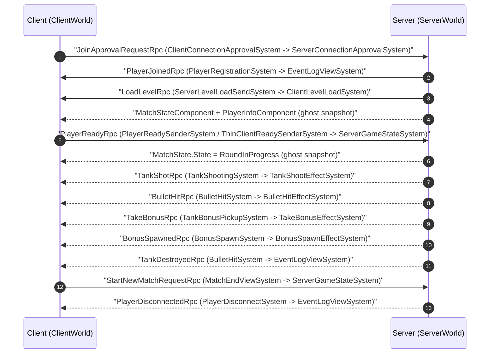

# Client Connection and Game Start

Sequence of RPC / command exchange between `ClientWorld` and `ServerWorld`
(self-host topology: Direct IP / Relay). The diagrams describe the default
**binary worlds** host mode; the experimental **single-world host** mode and its
deltas are covered in [Host world modes](#host-world-modes) below.
Source of truth: code under `Assets/Scripts/{Client,Server,Shared}`.

## Conventions

- **RPC** — `IRpcCommand` / `IApprovalRpcCommand` sent via `SendRpcCommandRequest`.
- **Broadcast** — `SendRpcCommandRequest` without `TargetConnection`; NetCode
  delivers the RPC to every `NetworkStreamInGame` connection.
- **Ghost** — not an RPC; a replicated snapshot component (`GhostComponent`),
  shown for context where it drives the flow.

## Sequence diagram

## Host world modes

Two host modes are supported; the sequence diagram above shows the default one.

### Binary worlds (default)

Separate `ClientWorld` and `ServerWorld` joined by an **IPC self-connection**
(`CustomDriverConstructor` registers the client IPC driver; `CustomNetcodeNetworkHandler`
self-connects after `Listen`). Every player — including the host — goes through the
full `JoinApprovalRequestRpc` round trip shown above.

### Single-world host (experimental, opt-in)

Enabled by the `NETCODE_EXPERIMENTAL_SINGLE_WORLD_HOST` scripting define **and**
`NetCodeConfig.HostWorldModeSelection = SingleWorld` (NetCode tab in Project Settings).
Both flags are currently **disabled** in this project, so the default flow applies.
A single `HostWorld` (client + server systems, `WorldFlags.GameClient | GameServer`)
replaces the two worlds. The IPC client driver and the loopback self-connect are skipped.
There is no client-to-server transport at all. The host player is a fake connection entity
created by NetCode: `LocalConnection` + `NetworkId`, without a `NetworkStreamConnection`/driver.

## Key notes

- **Approval-based join**: the client sends
  `JoinApprovalRequestRpc` during the NetCode **Handshake/Approval** phase
  (`IApprovalRpcCommand`, delivered before the game scene loads).
  `ServerConnectionApprovalSystem` validates `MatchState == WaitingForPlayers` and the
  8-player cap; on success it adds `ConnectionApproved` + `JoinedPlayerComponent`
  (+ `SpectatorTag` for spectators). `NetworkStreamInGame` is added in a second
  pass.
- **Rejection reason reporting**: NetCode destroys the client's connection entity the same
  tick it goes `Disconnected`, and `ConnectionEventsForTick` is cleared at the start of the
  next receive update — so the async connect-polls (`CustomNetcodeNetworkHandler`,
  `ConnectionManager.ConnectToIpPortServer`) cannot read the reason themselves.
  `ClientConnectionStateSystem` copies the last per-tick connection event (state + disconnect
  reason, keyed by the connection entity so stale records from previous attempts never match)
  into a `ClientConnectionStateComponent` singleton, and `ConnectionErrors.GetRejectMessage`
  maps it to messages: `InvalidRpc`/`BadProtocolVersion` → version mismatch (the client
  detects a handshake protocol mismatch itself), `ApprovalFailure` / `ConnectionClose` /
  `ClosedByRemote` → match in progress or server full, timeouts → timeout messages.
- **`PlayerJoinedRpc` + player registration** happen in `PlayerRegistrationSystem`,
  which appends a `PlayerInfoComponent` entry to the ghosted player-info buffer on
  the `MatchState` singleton and broadcasts the join notification only after the
  `NetworkId` is assigned.
- **Tank spawning** happens exclusively in `TankSpawnSystem`, once per round per
  connection: it requires the level to exist (`LevelDataComponent`), a
  `JoinedPlayerComponent` connection that is not a `SpectatorTag`, and no
  `TankSpawnedTag` (added by the system itself on successful spawn).
- **Round 1 start** is gated by `AreAllPlayersReady()` (flags set from `PlayerReadyRpc`);
  later rounds start on a timer (3 s after `DestroyLevel`). `Ready` is checked only for
  the first round.
- **RoundFinished** -> when the `RoundFinished` countdown expires the server moves to
  `WaitingForPlayers` and `DestroyLevel` detaches every connection (real clients and
  bots) from its tank and removes `LevelSentTag` + `TankSpawnedTag`.
- **Gameplay RPCs** (`TankShotRpc`, `BulletHitRpc`, `TakeBonusRpc`,
  `TankDestroyedRpc`, `BonusSpawnedRpc`) are produced by server-authoritative shared
  systems; only the server attaches `SendRpcCommandRequest`, so clients never send
  them. `TankShotRpc` and `TakeBonusRpc` are additionally created on clients as
  **local predicted events** (no `SendRpcCommandRequest`) so the firing/pickup effect
  plays immediately on the shooting client; the server's echo is skipped for the
  local player. `BulletHitRpc`/`TankDestroyedRpc` are effectively server-only
  (`BulletHitEvent` is emitted only on the server). Clients otherwise just render
  the received events.
- **Bots** (`BotConnectionsCreateSystem`) are fake connections (`BotConnectionTag`)
  that persist across rounds. They are excluded from `ServerLevelLoadSendSystem`
  (`WithNone<BotConnectionTag>`), so they never receive `LoadLevelRpc`, but
  they still register, spawn tanks via `TankSpawnSystem`, score, and emit kill RPCs.
