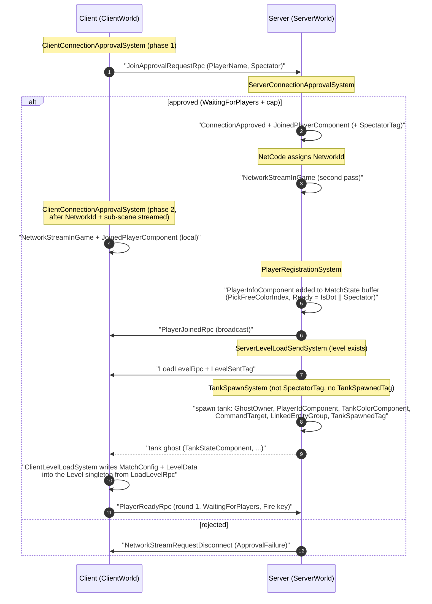
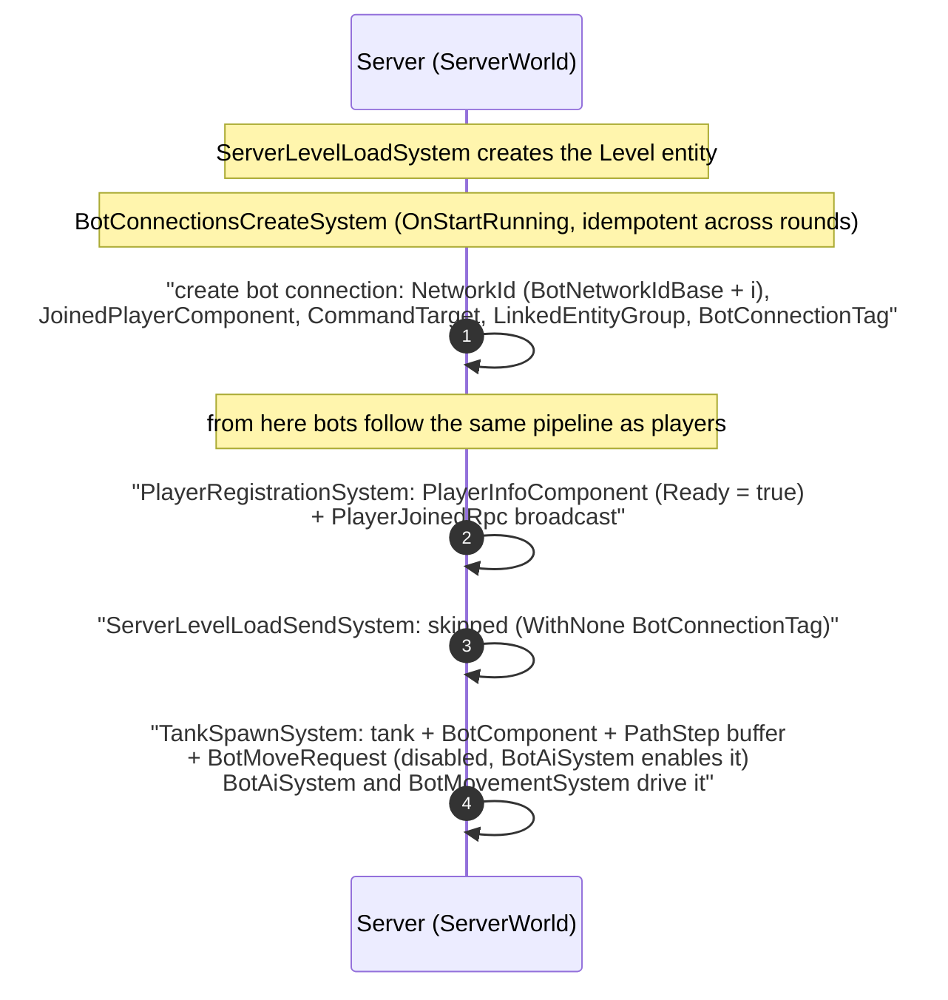

# Player and Bot Lifecycle

How a participant (real player or bot) joins the session, gets registered, receives
the level and a tank, and what happens on disconnect. Transport-level details
(approval RPCs, ghost replication) are covered in `connection-flow.md`.
Source of truth: code under `Assets/Scripts/{Client,Server,Shared}`.

## Conventions

- **RPC** — `IRpcCommand` / `IApprovalRpcCommand` sent via `SendRpcCommandRequest`.
- **Broadcast** — `SendRpcCommandRequest` without `TargetConnection`; NetCode
  delivers the RPC to every `NetworkStreamInGame` connection.
- **Ghost** — not an RPC; a replicated snapshot component (`GhostComponent`).
- The vertical order inside the diagrams is **logical**, not strict wall-clock time:
  steps 4–9 all happen within a couple of server frames once the level exists.

## Real player sequence

## Host player (single-world mode)

In the experimental single-world host mode (see `connection-flow.md` → Host world
modes; currently disabled in this project) the host player skips steps 1–3 of the
sequence above — there is no approval round trip and no separate server world:

- `ClientConnectionApprovalSystem` phase 1 is skipped (`IsHost()`); phase 2 runs
  directly on NetCode's fake `LocalConnection` + `NetworkId` connection entity once
  the sub-scene has streamed in: `JoinedPlayerComponent` (+ `SpectatorTag` when
  spectating) and `NetworkStreamInGame`.
- From `PlayerRegistrationSystem` onward the host player follows the exact same
  pipeline as a remote client — server and client systems execute in the same
  `HostWorld`, and `PlayerReadyRpc` / `StartNewMatchRequestRpc` reach the server
  logic via NetCode's host passthrough.

## Bot path

Bots skip the transport entirely: `BotConnectionsCreateSystem` fabricates
connection entities that plug into the same server pipeline as real players.

## Disconnect

Handled by `PlayerDisconnectSystem` (server), for any connection state transition
to `Disconnected`:

1. The player's `PlayerInfoComponent` roster entry is updated:
   `Disconnected = true`. `NetworkId` is **kept** (not reset) so existing lookups by
   network id keep working (e.g. kill-message resolution). The entry **survives** —
   the scoreboard keeps showing the player (as `OFFLINE`) for the rest of the session.
2. `PlayerDisconnectedRpc` is broadcast; clients render it via `EventLogViewSystem`.
3. NetCode destroys the connection entity, so `JoinedPlayerComponent` and the
   `TankSpawnedTag` disappear with it. The tank entity itself is not destroyed by
   this system; `ServerGameStateSystem` ignores tanks whose connection no longer
   has `JoinedPlayerComponent` when picking a round winner.

On the client, `ClientLocalDisconnectSystem` mirrors step 1 for the **local**
player's own entry: once its connection drops no further ghost updates arrive, so
the entry is marked `Disconnected` locally to keep the scoreboard current.

## Key notes

- **Server ordering chain** (all `ServerSimulation`):
  `ServerLevelLoadSystem` → `BotConnectionsCreateSystem` →
  `PlayerRegistrationSystem` → `ServerLevelLoadSendSystem` → `TankSpawnSystem`.
  A newly joined player (or freshly created bot) flows through the whole chain
  within one or two frames.
- **Registration is immediate**: `PlayerRegistrationSystem` writes the
  `PlayerInfoComponent` entry directly into the MatchState buffer (not via ECB),
  so `TankSpawnSystem` — ordered after it — can read the palette `ColorIndex` in
  the same frame. `PlayerJoinedRpc` goes through the BeginSimulation ECB.
- **One tank per round**: `TankSpawnSystem` adds `TankSpawnedTag` on successful
  spawn; a destroyed tank (`BulletHitSystem` detaches it and nulls `CommandTarget`)
  stays dead until the next round. `DestroyLevel` removes `TankSpawnedTag` (and
  `LevelSentTag`) from every connection and detaches tanks, so the next round
  respawns everyone. This also covers paths that skip `StopMatch`
  (e.g. `StartNewMatchRequestRpc`).
- **`LevelSentTag`** is a real-client-only marker (bots are excluded from
  `ServerLevelLoadSendSystem` via `WithNone<BotConnectionTag>`); it prevents
  duplicate `LoadLevelRpc` sends and is removed by `DestroyLevel` so the
  snapshot is re-sent next round. Tank spawning does not depend on it.
- **`StartNewMatchRequestRpc`** is honored only while `MatchState == MatchFinished`
  (sent by `MatchEndViewSystem` from the match-end screen); in any other state the
  RPC entity is destroyed and ignored.
- **Spectators** are approved like players (`SpectatorTag`), registered with
  `Spectator = true` and `Ready = true`, receive the level snapshot, but never
  get a tank (`WithNone<SpectatorTag>` in the spawn query).
- **Ready gating**: only round 1 waits for `AreAllPlayersReady()`; bots and
  spectators are `Ready` from registration. `StartNewMatch` resets `WinsCount`
  and clears `Ready` for humans (bots stay ready).
- **Local connection lookup**: client systems (approval phase 2, ready sender,
  thin-client input/ready, match-end view) find their own connection via the
  `LocalConnection` singleton — valid in pure client, thin-client and
  single-world-host worlds alike (`NetworkId` is not a singleton in a host world).
  In single-world host mode the host's `SpectatorTag` is also applied there,
  since `ServerConnectionApprovalSystem` never sees the fake connection.
