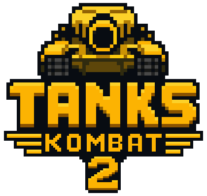
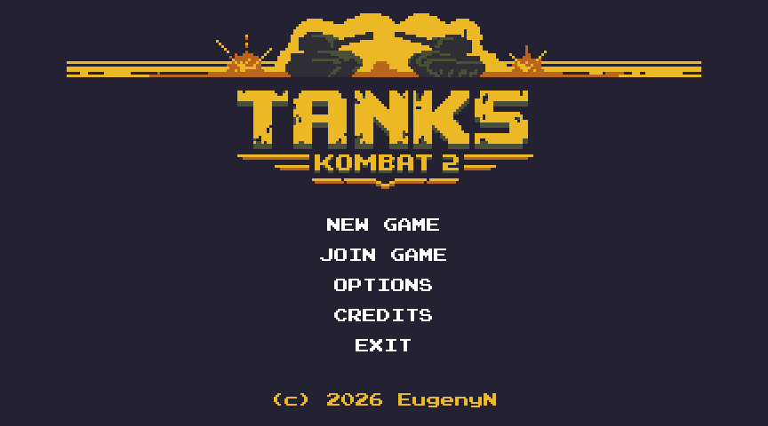
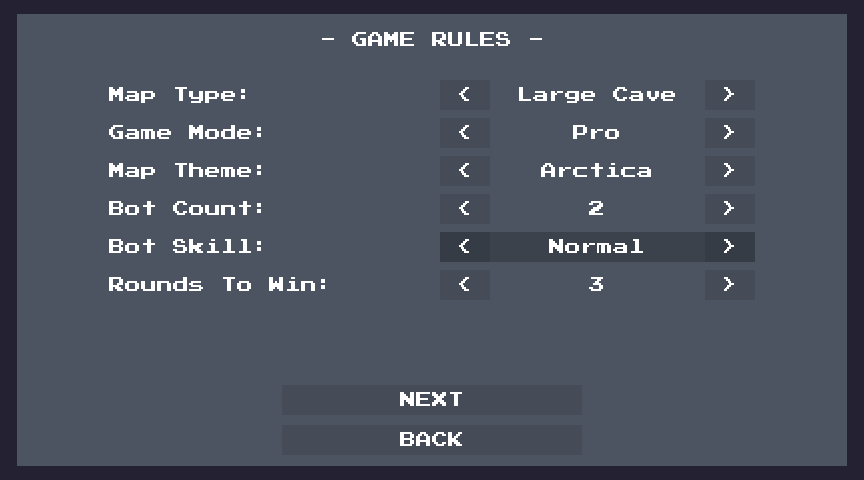
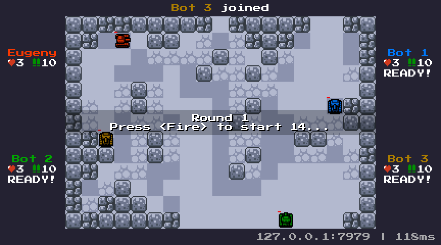
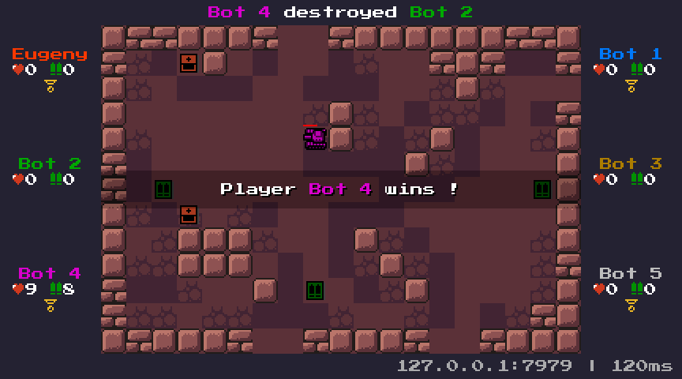

# Tanks Kombat 2

A retro-style multiplayer tank battle game. Players control tanks, move across a grid-based arena, and fight other players in fast battles. The project was built to explore the capabilities and limitations of [Unity NetCode for Entities](https://docs.unity3d.com/Packages/com.unity.netcode@6.6/manual/index.html) and the [Unity DOTS](https://unity.com/dots) ecosystem for fast-paced competitive gameplay. It uses an authoritative-server model with client-side prediction to keep tank controls responsive while maintaining a consistent game state across players.

  &nbsp;&nbsp;
  

  &nbsp;&nbsp;
  

## Description and rules

* At its heart, **Tanks Kombat 2** is a short, high-tempo match fought on a small, fully visible arena. The arena is a **discrete grid**: the player moves their tank instantly, cell by cell - one button press equals one move. Skill lies in **reading the opponent**: their intentions, movement, and feints. Mastery means understanding the arena's lines of fire and distance, and knowing when to strike. When a tank runs **out of ammo**, the match turns into a chase-and-escape game: the unarmed player must survive long enough to find an ammo pickup. The last surviving tank wins the round; the match goes to the first player to win the configured number of rounds (default 3).

* The game supports multiplayer for up to 8 players, as well as AI bots. The **Extra Large Cave** map is recommended for 8 players. A player can also join a match in **Spectator Mode**, observing the battle without participating.

* Several game modes that change the core rules are available:

| Mode           | Character                                                  |
|----------------|------------------------------------------------------------|
| **Standard**   | Balanced lives & ammo - the default.                       |
| **Pro**        | Fewer lives and less ammo - punishing mistakes.            |
| **Fire & Iron**| Single-shot duels - every shot must count.                 |
| **Quick Death**| Lots of lives, no invulnerability - pure chaos.            |

* Two types of bonus pickups - **Tank** (extra life) and **Ammo** - spawn on the arena.

* Arenas can be procedurally generated or selected from handcrafted custom maps. Custom maps are created and edited with the built-in **Map Editor**, available directly inside Unity via the `Tools → Map Editor`. See [`map-editor.md`](./Docs/map-editor.md) for details.

* The game supports **keyboard**, **XInput-compatible gamepads** (recommended), and **on-screen touch buttons** (Android). The tank is controlled with movement direction buttons, a Fire button, and a Block button that rotates the tank in place.

* Gameplay and mechanics draw from **'90s console fighters** and **classic arcade games** - notably **Bomberman**, **Pac-Man**, and logic puzzles like **Laser Tank** - as well as reaction-driven play like fencing and tag/chase. The project is also intended as a testing ground for experimenting with additional mechanics.

## Tech details

* **Authoritative server + client prediction** - the game uses the classic architecture found in competitive shooters: the server is the single source of truth, while clients predict locally and reconcile against every incoming snapshot (rolling back and replaying as needed). The gameplay simulation runs at **60 Hz** on both client and server.

* **Connection types** - matches support **Direct IP** and **Unity Relay** (Unity Multiplayer Services). Direct IP provides a low-latency path for LAN games or known hosts, while Relay allows players to connect behind NAT or firewalls without port forwarding.

* The primary topology is **self-hosted** (player-hosted), so a player can host a match without a separate server build; a headless **dedicated server** topology is also supported. Although NetCode for Entities supports host migration, it is not yet implemented in the current version of the game.

* By default, the **binary-world** host model is used - the client and server worlds are created and run in the same process. An experimental **single-world** host mode is also supported: client and server systems run in one host world. It is disabled by default - to activate it, add the `NETCODE_EXPERIMENTAL_SINGLE_WORLD_HOST` scripting define and select **SingleWorld** in the `NetCodeConfig` asset.

* Code is split into separate assemblies (`.asmdef`), primarily **Client**, **Server**, and **Shared**. The **Shared** assembly contains code built into both client and server worlds. `defineConstraints` controls which assemblies are compiled into client vs. dedicated-server builds.

* **Custom retro rendering** - rendering uses the [Entities Graphics](https://docs.unity3d.com/Packages/com.unity.entities.graphics@6.6) library. Tiles and sprites are drawn with a custom shader (`TiledAtlasUnlit`) that supports sprite atlases, per-entity animation via material properties, and DOTS instancing. The orthographic camera is locked to a fixed **864×480**.

* **Server-side bot AI** - players can add bots to a match; they are simulated entirely on the server, and their difficulty is configurable.

* See [`AGENTS.md`](./AGENTS.md) for the more detailed **architecture guide** and coding conventions. For the network flows, see [`connection-flow.md`](./Docs/connection-flow.md) (client connection and game start) and [`player-flow.md`](./Docs/player-flow.md) (player and bot lifecycle).

* The project uses **Build Profiles**: `Windows Self-Hosted`, `Windows Server` (dedicated server), `Linux Self-Hosted` (including Steam Deck) and `Android Self-Hosted`. Build via `File → Build Profiles`, select a profile, and press **Build**.

## Run in the Unity Editor

The project ships **two entry scenes**, both playable directly from the Editor:

1. **`Assets/Scenes/Frontend.unity`** - boots into the **main menu**, where you configure match settings, choose a connection mode (Direct IP / Unity Relay), and start or join a game.
2. **`Assets/Scenes/GameScene.unity`** - **quick-start**: creates client and server worlds automatically, then connects to port **7979**. Use `-port <n>` in a build to override the port.

Open either scene and press **Play**.

**Thin clients**: basic thin-client support is implemented - enable it through **PlayMode Tools** in the Editor to spin up additional simulated clients for testing.

## Downloads

Builds for **Android**, **Windows**, and **Linux** are available on the [Releases page](../../releases).

## Credits

* **Programming, game design, and some art**: Eugeny Novikov
* **Music**: [Beatscribe](https://github.com/Beatscribe/homebrew_vgm)
* **Sprites, BG tiles**: RottingPixels, zironid_n, Kenney Vleugels, some 8-bit, 16-bit retro games
* **LLMs**: GLM 5.x, ChatGPT Images 2.0

## License

Copyright (c) 2026 Eugeny Novikov. The source code is under the MIT license. See [LICENSE](LICENSE).

Third-party assets (music, sprites, and background tiles) are not covered by the MIT license and remain under their respective owners' licenses and copyrights.
